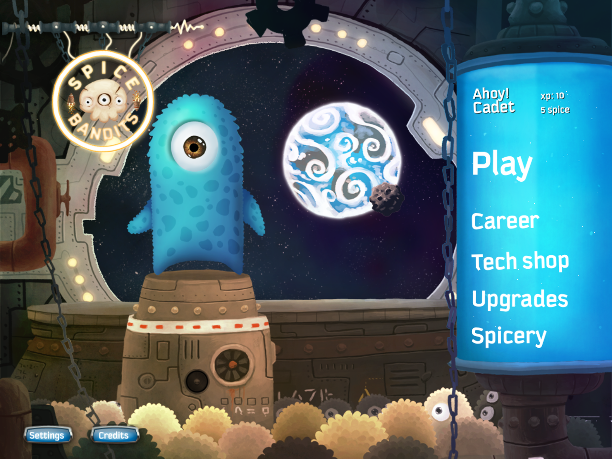
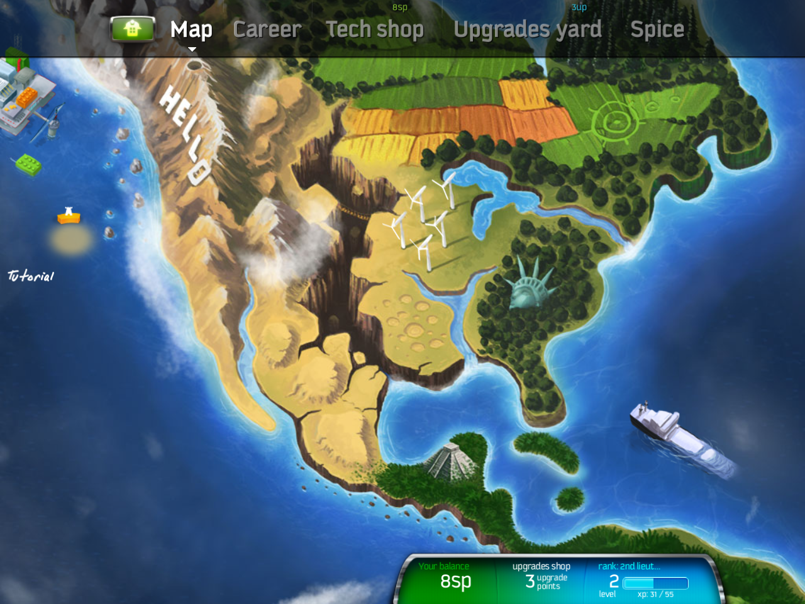
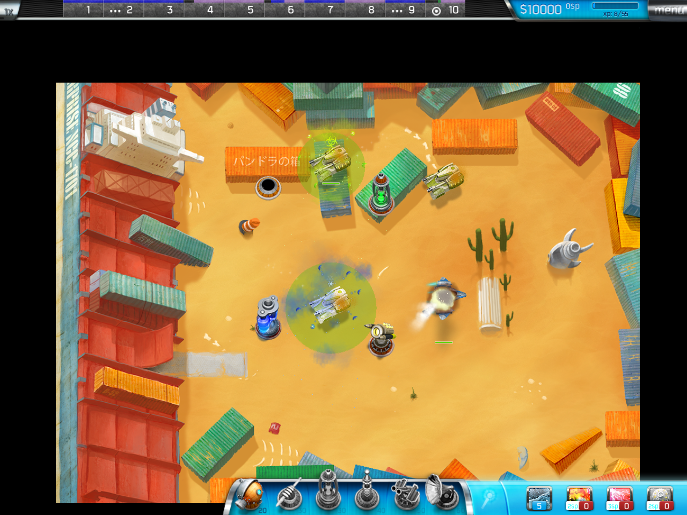
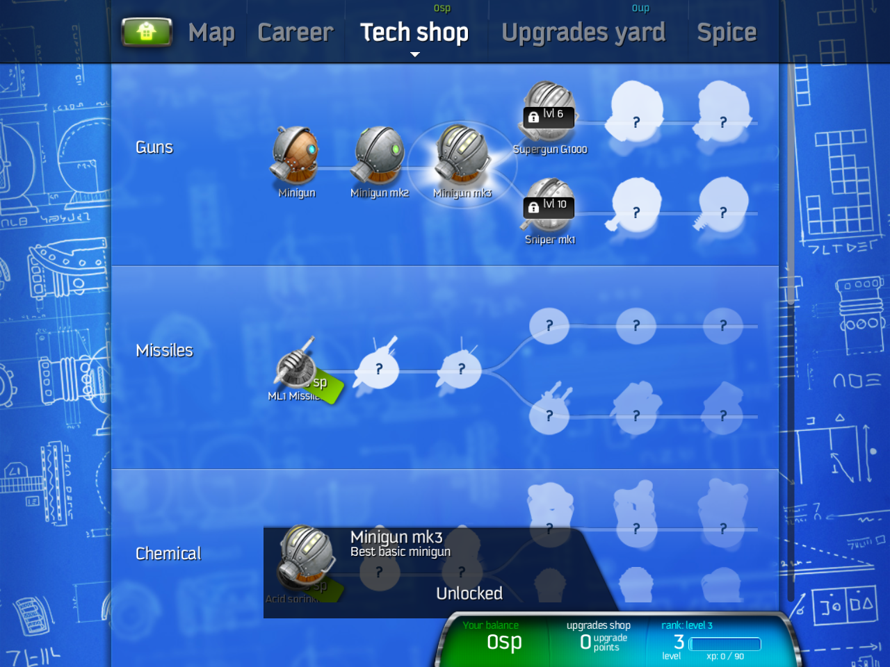

<p align="center"></p>

<h1 align="center">Spice Bandits: Remastered</h1>

<p align="center"><strong>Bringing a classic iOS tower-defense game to macOS.</strong></p>

<p align="center">A preservation and reverse-engineering project rebuilding the original game's rules, animated world, and single-player campaign in a new desktop runtime.</p>

<p align="center">
  <a href="#the-game">The game</a> · <a href="#the-project">The project</a> · <a href="#screenshots">Screenshots</a> · <a href="#current-status">Status</a> · <a href="#building-and-exploring">Get started</a> · <a href="documentation/README.md">Documentation</a>
</p>

<p align="center">
  
  
  
  
</p>

## The game

**Spice Bandits**, also known as **Spice Invaders**, is an iOS tower-defense game about alien pirates collecting spice on Earth. You place and upgrade towers, shape enemy routes, and use special abilities to protect your base through waves of attackers. Its personality comes from expressive creatures, branching tower upgrades, animated scenery, and a world-map campaign.

The original was built for older iOS hardware and services. Preserving its files is only part of preserving the game: the rules, timing, animation, interface, and progression also need a runtime that can use them on a modern computer.

## The project

**Spice Bandits: Remastered** is an unofficial reconstruction for macOS. It combines preserved game data and media with behavior recovered from the original compiled executable, then implements that behavior in Godot and a selective C++ native helper.

The goal is to recover the original experience: its campaign, tower branches, enemy behavior, effects, sound, and visual proportions, with desktop controls. The original single-player game comes first. Multiplayer restoration is a later, separate goal; new content and rebalancing are deferred.

This repository contains the reconstruction source, import and analysis tools, reference fixtures, and the research trail behind implementation decisions. The original game's source project was not recovered, and the original iOS executable is not the desktop application.

## Screenshots

Screenshots from the current **R200 macOS development build**. Captured in isolated test sessions; combat and shop views include staged states.

<p align="center">
  <a href="documentation/assets/screenshots/main-menu.png"></a>
  <a href="documentation/assets/screenshots/campaign-map.png"></a>
</p>
<p align="center"><em>Main menu · Campaign map</em></p>

<p align="center">
  <a href="documentation/assets/screenshots/combat.png"></a>
  <a href="documentation/assets/screenshots/tech-shop.png"></a>
</p>
<p align="center"><em>Combat and effects · Tower upgrade branches</em></p>

Select any screenshot to view it at full resolution. [Image sources](documentation/assets/README.md).

## Current status

**Playable development builds exist; complete original-game fidelity remains unfinished.** The latest documented package is **R200**, reviewed on October 19, 2026. Revision labels identify research and build checkpoints, not public release versions.

| Area | Where things stand |
| --- | --- |
| Campaign content | All 148 nonempty offline wave schedules load; all 54 map IDs they require are present in the preserved inputs. |
| Offline gameplay | Placement, upgrades, selling, combat, abilities, tutorial, menus, results, local saves, and progression adaptations are implemented. |
| Recovered mechanics | Selected original ARM functions are executed in bounded test harnesses and compared with the reconstructed rules. Each harness records its supplied inputs and external callbacks. |
| Latest functional review | All eight functional suites and the automated presentation suite pass for R200; human visual review still rejects the first projectile capture because terrain and HUD are missing. |
| Performance | R200 fails the unchanged 33.34 ms median frame-time limit at 1×, 2×, and 4× speed. |
| Remaining fidelity | Interface and interaction matching, complete effect ownership and update order, audio, original randomness, and hosted progression still have documented gaps. |
| Multiplayer and distribution | Multiplayer is not restored. Intel execution, notarized distribution, physical trackpad verification, and speaker listening remain unverified. |

See the [readable status report](documentation/status.md), [exact R200 review](docs/validation/2026-10-19-r200-packaged-native-review.json), and [fidelity record](docs/FIDELITY.md). Passing a selected mechanics test does not establish whole-game equivalence.

## Building and exploring

**A source clone alone cannot run the game.** Original archives, extracted content, and generated runtime assets are excluded from the Git source tree. Existing [release archives](https://github.com/ctadros1/spice-bandits-remastered/releases) are historical preservation and recovery checkpoints; they are not a declaration that the latest remaster is complete or ready for general distribution. Some checkpoint records refer to draft releases, which are unavailable to public readers.

Start with the [setup guide](documentation/getting-started.md) for the required preserved-input layout and pinned toolchain. With those prerequisites in place:

```sh
git clone https://github.com/ctadros1/spice-bandits-remastered.git
cd spice-bandits-remastered

# Verify inputs, import content, build the native helper, and run source checks.
zsh tools/build_macos.sh --verify-only

# Run the same checks, then export the macOS application.
zsh tools/build_macos.sh
open 'builds/Spice Bandits Remastered.app'
```

The current build pins Godot **4.7.2**, uses Python for import and research tools, and builds a Universal2 C++ GDExtension. See the [architecture guide](documentation/architecture.md) and [detailed build record](docs/BUILD.md).

## Documentation

| Start here | What you will find |
| --- | --- |
| [Documentation hub](documentation/README.md) | Reading paths for players, developers, and preservation researchers. |
| [Reverse-engineering process](documentation/reverse-engineering/README.md) | How evidence becomes a reconstructed behavior. |
| [Preservation and asset recovery](documentation/reverse-engineering/preservation-and-assets.md) | Archive integrity, version boundaries, images, maps, audio, and interface data. |
| [Binary analysis and emulation](documentation/reverse-engineering/binary-analysis.md) | Symbols, ARM harnesses, explicit callbacks, and exact comparisons. |
| [Worked case studies](documentation/reverse-engineering/case-studies.md) | Concrete discoveries and their implementation limits. |
| [Verification and fidelity](documentation/reverse-engineering/verification.md) | Source checks, packaged checks, visual review, performance, and reproducibility. |
| [Research source catalog](research/SOURCES.md) | Footage, reviews, references, and provenance. |
| [Mechanics specifications](documentation/reverse-engineering/README.md#mechanics-reference) | Detailed subsystem notes linked to probes and verification tools. |

The [implementation plan](PLAN.md), [developer handoff](HANDOFF.md), and [archived README checkpoint log](docs/README_CHECKPOINTS.md) retain the detailed development history.

## Attribution and rights

This is an independent preservation project, unaffiliated with the original game's creators or publisher. Spice Bandits / Spice Invaders names, artwork, audio, and other original materials belong to their respective rights holders.

No project-wide license has been added. Public availability does not grant permission to reuse or redistribute the original game materials. The separately included [godot-cpp license](native/GODOT-CPP-LICENSE.txt) applies to those bindings.
